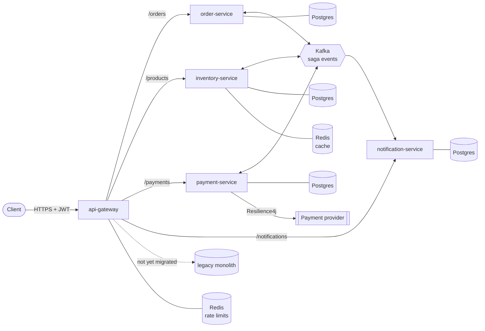
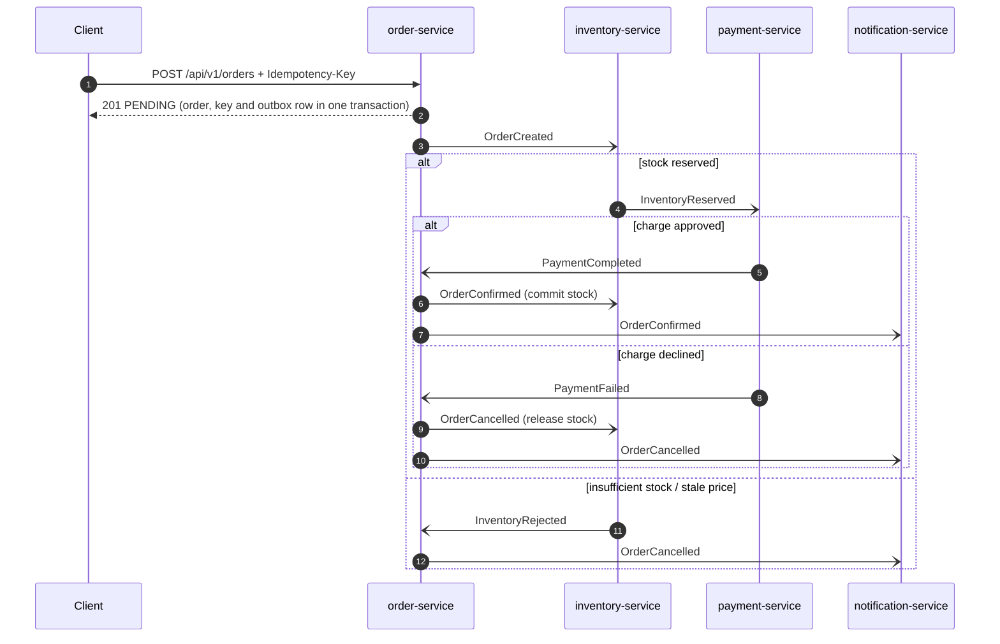

# EventFlow Commerce

[](https://github.com/rkunameneni/eventflow-commerce/actions/workflows/ci.yml)


[](LICENSE)

EventFlow Commerce is an event-driven order-fulfilment platform: the checkout core of an online
shop, carved out of a monolith with the strangler-fig pattern into Spring Boot microservices that
cooperate through a choreographed Kafka saga. An order is confirmed only when its stock is
reserved and the customer has been charged; if either step fails, the order is cancelled and the
completed steps are compensated. The project focuses on the parts that are hard in production -
atomic state-plus-event writes (transactional outbox), idempotency at every boundary, retries with
dead-letter topics and replay, resilience against a flaky payment provider, and end-to-end
observability - and runs locally with one `docker compose up`.

## Architecture



### The saga



More detail - topics, reliability mechanisms, security and observability - is in
[docs/architecture.md](docs/architecture.md); the key decisions are recorded as ADRs:

* [ADR 0001 - Strangler-fig decomposition](docs/adr/0001-strangler-fig-decomposition.md)
* [ADR 0002 - Choreographed saga with a transactional outbox](docs/adr/0002-choreographed-saga-with-transactional-outbox.md)
* [ADR 0003 - Idempotency at every boundary](docs/adr/0003-idempotency-at-every-boundary.md)

## Modules

| Module | Purpose |
|---|---|
| [`common-events`](common-events) | Saga event records (sealed hierarchy), topic names, JSON codec and JSON Schemas |
| [`service-support`](service-support) | In-house Spring Boot starter used by all servlet services (outbox, idempotent consumers, DLT, security, errors, logging) |
| [`api-gateway`](api-gateway) | Spring Cloud Gateway: routing, JWT validation, Redis rate limiting, strangler fallback |
| [`order-service`](order-service) | Order API and saga state owner |
| [`inventory-service`](inventory-service) | Catalogue with Redis cache-aside; stock reservation and compensation |
| [`payment-service`](payment-service) | Charges via pluggable providers guarded by Resilience4j |
| [`notification-service`](notification-service) | Customer notifications for order outcomes |
| [`acceptance-tests`](acceptance-tests) | Cucumber scenarios running the whole saga in one JVM against Testcontainers |

## Tech stack and where to find it

| Feature | Technology | Implementation |
|---|---|---|
| Language / build | Java 21 (records, sealed types, pattern-matching `switch`, virtual threads), Maven multi-module + wrapper | [`pom.xml`](pom.xml), [`ChargeResult`](payment-service/src/main/java/io/github/rkunameneni/eventflow/payment/provider/ChargeResult.java), [`PaymentGatewayConfig`](payment-service/src/main/java/io/github/rkunameneni/eventflow/payment/provider/PaymentGatewayConfig.java) |
| API gateway | Spring Cloud Gateway (WebFlux) | [`api-gateway/.../application.yml`](api-gateway/src/main/resources/application.yml) |
| Rate limiting | `RequestRateLimiter` + Redis token bucket, keyed per user or client IP | [`RateLimitConfig`](api-gateway/src/main/java/io/github/rkunameneni/eventflow/gateway/routing/RateLimitConfig.java) |
| Strangler fig | Catch-all route to the legacy monolith | [`StranglerFallbackRouteConfig`](api-gateway/src/main/java/io/github/rkunameneni/eventflow/gateway/routing/StranglerFallbackRouteConfig.java) |
| Security | Spring Security OAuth2 resource server (JWT), `@PreAuthorize` method security | [`ResourceServerAutoConfiguration`](service-support/src/main/java/io/github/rkunameneni/eventflow/support/config/ResourceServerAutoConfiguration.java), [`GatewaySecurityConfig`](api-gateway/src/main/java/io/github/rkunameneni/eventflow/gateway/security/GatewaySecurityConfig.java) |
| Persistence | Spring Data JPA / Hibernate, PostgreSQL, Flyway | [`Order`](order-service/src/main/java/io/github/rkunameneni/eventflow/order/domain/Order.java), [`db/migration`](order-service/src/main/resources/db/migration/order) |
| Caching | Spring Cache + Redis, cache-aside, per-cache TTLs, transaction-aware eviction | [`CatalogService`](inventory-service/src/main/java/io/github/rkunameneni/eventflow/inventory/application/CatalogService.java), [`CacheConfig`](inventory-service/src/main/java/io/github/rkunameneni/eventflow/inventory/config/CacheConfig.java) |
| Messaging | Apache Kafka (KRaft), Spring Kafka, one topic per event type | [`Topics`](common-events/src/main/java/io/github/rkunameneni/eventflow/events/Topics.java) |
| Saga | Choreography with compensation | [`OrderSagaHandler`](order-service/src/main/java/io/github/rkunameneni/eventflow/order/application/OrderSagaHandler.java), [`ReservationService`](inventory-service/src/main/java/io/github/rkunameneni/eventflow/inventory/application/ReservationService.java) |
| Transactional outbox | JDBC outbox + `SKIP LOCKED` relay | [`OutboxWriter`](service-support/src/main/java/io/github/rkunameneni/eventflow/support/messaging/OutboxWriter.java), [`OutboxRelay`](service-support/src/main/java/io/github/rkunameneni/eventflow/support/messaging/OutboxRelay.java) |
| Retries and DLT | `DefaultErrorHandler`, exponential back-off, `DeadLetterPublishingRecoverer` | [`MessagingAutoConfiguration`](service-support/src/main/java/io/github/rkunameneni/eventflow/support/config/MessagingAutoConfiguration.java) |
| DLT replay | Admin endpoint republishing dead letters | [`DeadLetterReplayer`](service-support/src/main/java/io/github/rkunameneni/eventflow/support/messaging/DeadLetterReplayer.java) |
| Idempotency | `Idempotency-Key` API, processed-event table | [`OrderPlacementService`](order-service/src/main/java/io/github/rkunameneni/eventflow/order/application/OrderPlacementService.java), [`ProcessedEventStore`](service-support/src/main/java/io/github/rkunameneni/eventflow/support/messaging/ProcessedEventStore.java) |
| Resilience | Resilience4j retry + circuit breaker + time limiter | [`ResilientPaymentGateway`](payment-service/src/main/java/io/github/rkunameneni/eventflow/payment/provider/ResilientPaymentGateway.java) |
| Design patterns | Strategy + factory (payment providers, notification channels), decorator (resilience), outbox, saga | [`PaymentProvider`](payment-service/src/main/java/io/github/rkunameneni/eventflow/payment/provider/PaymentProvider.java), [`PaymentProviderFactory`](payment-service/src/main/java/io/github/rkunameneni/eventflow/payment/provider/PaymentProviderFactory.java), [`NotificationSender`](notification-service/src/main/java/io/github/rkunameneni/eventflow/notification/application/NotificationSender.java) |
| REST API | `/api/v1`, Bean Validation, RFC 7807 `ProblemDetail`, pagination, springdoc OpenAPI | [`OrderController`](order-service/src/main/java/io/github/rkunameneni/eventflow/order/web/OrderController.java), [`ProblemDetailsAdvice`](service-support/src/main/java/io/github/rkunameneni/eventflow/support/web/error/ProblemDetailsAdvice.java) |
| Observability | Actuator, Micrometer + Prometheus, Micrometer Tracing (OpenTelemetry), JSON logs, ELK | [`logback-spring.xml`](service-support/src/main/resources/logback-spring.xml), [`observability/`](observability) |
| Testing | JUnit 5, Mockito, Testcontainers, REST Assured, WireMock, Cucumber | [Testing](#testing) |
| Containers | Multi-stage Dockerfiles, layered jars, non-root | [`order-service/Dockerfile`](order-service/Dockerfile), [`docker-compose.yml`](docker-compose.yml) |
| Kubernetes | Manifests (Kustomize) and a Helm chart with HPA, PDB, probes | [`deploy/k8s`](deploy/k8s), [`deploy/helm/eventflow`](deploy/helm/eventflow) |
| AWS | Terraform: VPC, ALB, ECS Fargate + autoscaling, RDS, ElastiCache, MSK, Secrets Manager, SSM, CloudWatch, X-Ray, Route 53, ECR | [`infra/terraform`](infra/terraform) |
| CI/CD | GitHub Actions, Jenkins, SonarCloud, Trivy | [`.github/workflows/ci.yml`](.github/workflows/ci.yml), [`Jenkinsfile`](Jenkinsfile) |

## Quickstart

Requirements: Docker with Compose v2 (about 4 GB of memory for the stack). JDK 21 only if you
want to build outside Docker.

```bash
docker compose up --build        # first build takes a few minutes
```

| URL | What |
|---|---|
| http://localhost:8080 | API gateway (the only entry point clients need) |
| http://localhost:8081/swagger-ui.html | Order API (also 8082 inventory, 8083 payments, 8084 notifications) |
| http://localhost:9090/__admin/mappings | Mock payment provider (WireMock) |

With the observability overlay (Kibana on 5601, Prometheus on 9091, Jaeger on 16686):

```bash
docker compose -f docker-compose.yml -f observability/docker-compose.yml up --build
```

### Try it

The gateway can issue demo tokens (enabled in docker-compose only). Users: `alice`, `bob`
(customers), `admin`, and `chaos` / `slowpoke`, customers for whom the mock provider fails or
responds slowly.

```bash
token() { curl -s localhost:8080/api/v1/auth/token -H 'Content-Type: application/json' \
            -d "{\"username\":\"$1\",\"password\":\"$1-password\"}" | jq -r .accessToken; }
ALICE=$(token alice); ADMIN=$(token admin)

# The catalogue is public (and served from Redis after the first read)
curl -s localhost:8080/api/v1/products | jq '.content[] | {sku, unitPrice}'

# Place an order - retrying with the same Idempotency-Key returns the same order
KEY=$(uuidgen)
ORDER=$(curl -s localhost:8080/api/v1/orders -H "Authorization: Bearer $ALICE" \
  -H "Idempotency-Key: $KEY" -H 'Content-Type: application/json' \
  -d '{"currency":"USD","lines":[{"sku":"SKU-KEYBOARD","quantity":1,"unitPrice":79.00}]}' | jq -r .id)

# A moment later the saga has finished
curl -s localhost:8080/api/v1/orders/$ORDER -H "Authorization: Bearer $ALICE" | jq '{status, statusReason}'
curl -s localhost:8080/api/v1/payments/$ORDER -H "Authorization: Bearer $ALICE" | jq '{status, providerReference}'
curl -s localhost:8080/api/v1/notifications -H "Authorization: Bearer $ALICE" | jq '.content[0].subject'

# The mock provider declines charges above 1000.00 -> order CANCELLED, stock released
curl -s localhost:8080/api/v1/orders -H "Authorization: Bearer $ALICE" -H "Idempotency-Key: $(uuidgen)" \
  -H 'Content-Type: application/json' \
  -d '{"currency":"USD","lines":[{"sku":"SKU-LAPTOP","quantity":1,"unitPrice":1499.00}]}' | jq -r .id

# Validation errors are RFC 7807 problem documents
curl -s localhost:8080/api/v1/orders -H "Authorization: Bearer $ALICE" -H "Idempotency-Key: $(uuidgen)" \
  -H 'Content-Type: application/json' -d '{"currency":"usd","lines":[]}' | jq
```

Resilience and dead-letter handling: orders from `chaos` hit a provider that always answers 503.
The payment service retries, the circuit breaker opens after repeated failures, the Kafka consumer
backs off and finally parks the event on `eventflow.inventory.reserved.v1.DLT`; the order stays
`INVENTORY_RESERVED`. Once the provider is healthy again (e.g. delete the `chaos` stub via the
WireMock admin API), an operator replays the dead letters:

```bash
curl -s -X POST -H "Authorization: Bearer $ADMIN" \
  localhost:8080/api/v1/admin/payments/dlq/eventflow.inventory.reserved.v1/replay | jq
```

## Testing

```bash
./mvnw verify            # unit + integration + acceptance tests (needs Docker for Testcontainers)
./mvnw verify -Punit     # unit tests only (no Docker)
```

| Layer | Tools | Examples |
|---|---|---|
| Unit | JUnit 5, Mockito, AssertJ | Domain state machines (`OrderTest`), saga handlers with mocked ports (`OrderSagaHandlerTest`, `ReservationServiceTest`, `PaymentServiceTest`), Resilience4j behaviour (`ResilientPaymentGatewayTest`), JSON Schema contract (`EventSchemaContractTest`) |
| HTTP contract | WireMock | `MockPayProviderTest` - status mapping, timeouts, idempotency header |
| Integration | Testcontainers (Postgres, Kafka, Redis), REST Assured | `OrderApiIT` (idempotency, validation, ownership, saga reactions), `InventoryIT` (cache-aside and eviction, duplicate delivery), `PaymentIT` (outage -> DLT -> replay), `MessagingPlatformIT` (outbox, retries, DLT), `GatewayIT` (auth, routing, rate limits) |
| Acceptance (BDD) | Cucumber, all four services in one JVM | [`order_saga.feature`](acceptance-tests/src/test/resources/features/order_saga.feature): happy path, declined payment with compensation, insufficient stock |

Integration test classes end in `IT` and run in the `integration-test` phase (Failsafe); the
containers are shared per module so they start once.

## Deployment

**Kubernetes.** A Helm chart renders a Deployment, Service, HPA and PodDisruptionBudget per
service from one template, with startup/liveness/readiness probes on the Actuator health groups,
a restricted security context (non-root, read-only root filesystem) and secrets referenced from an
existing Secret:

```bash
helm upgrade --install eventflow deploy/helm/eventflow -n eventflow --create-namespace \
  --set image.tag=<git-sha> --set config.KAFKA_BOOTSTRAP_SERVERS=<brokers>
```

Plain manifests for `kubectl apply -k deploy/k8s` are provided as well, including an
`ExternalSecret` that syncs credentials from AWS Secrets Manager.

**AWS with Terraform.** [`infra/terraform`](infra/terraform) provisions a VPC (public/private
subnets, NAT), an HTTPS ALB with a Route 53 alias, ECS Fargate services with target-tracking
autoscaling and Cloud Map service discovery, RDS PostgreSQL (encrypted, TLS enforced, password
managed by RDS in Secrets Manager), ElastiCache Redis (TLS, failover), Amazon MSK, ECR
repositories with scan-on-push, CloudWatch log groups and alarms, an SNS alarm topic, and an X-Ray
sampling rule fed by an ADOT collector sidecar. Each service gets its own execution role that can
read only its own secrets and parameters, and a task role limited to X-Ray.

```bash
cd infra/terraform
terraform init -backend-config=backend.hcl
terraform plan -var-file=staging.tfvars      # see terraform.tfvars.example
```

**CI/CD.** GitHub Actions builds and runs every test suite, runs SonarCloud analysis when a token
is configured, validates Terraform and the Helm chart, builds each image, scans it with Trivy and
pushes to GHCR from `main`. The [`Jenkinsfile`](Jenkinsfile) is the equivalent declarative
pipeline, with a SonarQube quality gate and a Helm deployment to staging.

## Design decisions

* **Choreography over orchestration.** Four participants and one compensation read naturally as
  events; there is no central coordinator to scale or keep available. See ADR 0002 for when this
  should be revisited.
* **Outbox everywhere, not only at the start of the saga.** Every service that emits events uses
  the same outbox from `service-support`, so no code path ever writes to the database and to Kafka
  separately.
* **Idempotency is layered.** API keys, consumer markers, guarded state transitions and provider
  idempotency keys each cover a different duplicate source (ADR 0003).
* **Quoted prices are verified, not trusted.** The order carries the prices the customer saw;
  inventory rejects the order if the catalogue price changed, instead of order-service calling
  inventory synchronously during checkout.
* **The provider call sits outside database transactions.** A slow provider cannot hold
  connections; the payment row created beforehand makes the call idempotent.
* **One topic per event type, keyed by order id.** Simple consumers, per-type retention and ACLs,
  and per-order ordering.
* **Business ids alongside trace ids.** Traces are sampled and broken by the asynchronous outbox
  hop; the correlation id always follows the saga.
* **Defence in depth for auth.** The gateway authenticates and rate-limits, but every service
  validates the token and authorizes per endpoint.
* **Service-specific config files.** Services read `<service>.yml` instead of
  `application.yml`, which lets the acceptance suite run all of them in one JVM.

## Project layout

```
common-events/          event contracts and JSON Schemas
service-support/        shared starter (outbox, consumers, security, errors, logging)
api-gateway/  order-service/  inventory-service/  payment-service/  notification-service/
acceptance-tests/       Cucumber saga scenarios
deploy/docker/          init scripts and mock payment provider stubs for docker-compose
deploy/k8s/             Kubernetes manifests (Kustomize)
deploy/helm/eventflow/  Helm chart
infra/terraform/        AWS infrastructure
observability/          ELK, Prometheus and Jaeger overlay for docker-compose
docs/                   architecture overview and ADRs
```

## License

[MIT](LICENSE)
