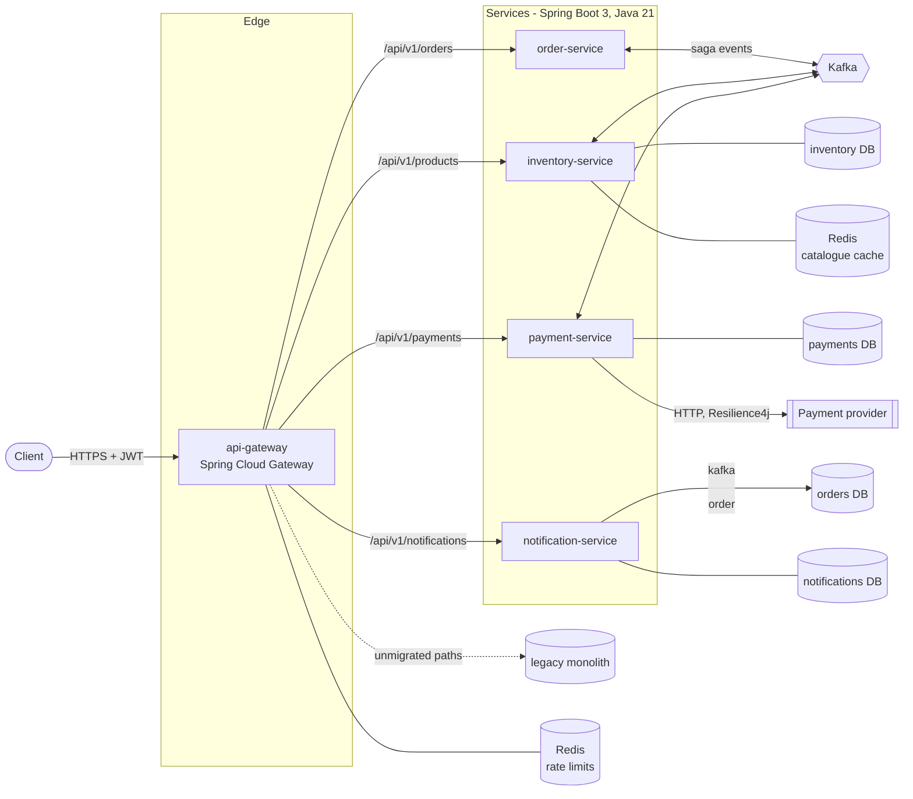
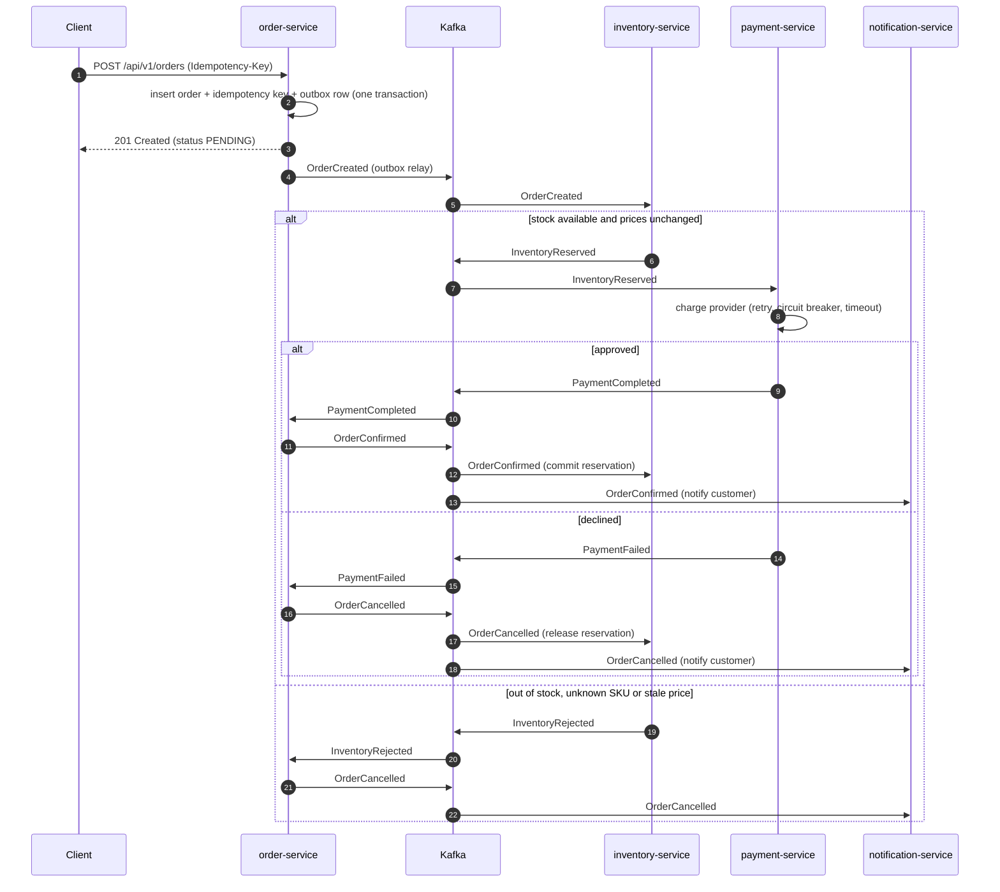

# Architecture

EventFlow Commerce is the order-fulfilment core of a web shop, decomposed from a monolith into
five deployables that collaborate through Kafka events. This page describes the runtime
architecture; the reasoning behind the main choices is recorded in the [ADRs](adr/).

## Components

| Component | Responsibility | Owns |
|---|---|---|
| `api-gateway` | Routing, JWT validation, per-user rate limiting (Redis token bucket), correlation ids, strangler-fig fallback to the monolith | Nothing persistent |
| `order-service` | Order API, idempotent order placement, saga state | `orders`, `order_items`, `idempotency_keys` |
| `inventory-service` | Catalogue, stock reservation and compensation, cache-aside reads | `products`, `reservations` |
| `payment-service` | Charges through a pluggable provider behind retry, circuit breaker and time limiter | `payments` |
| `notification-service` | Customer messages for final order outcomes | `notifications` |
| `common-events` | Event records and their JSON Schemas (the contract) | - |
| `service-support` | In-house starter: outbox, idempotent consumers, DLT handling and replay, security, RFC 7807 errors, logging | - |

Every service owns its data. In docker-compose each service has its own database; in AWS
they share one RDS instance with a schema per service (the schema is the ownership boundary, and
no service reads another's schema).

## The order saga

The saga is **choreographed**: no central orchestrator, each participant reacts to events and
publishes its own outcome.

### Topics

One topic per event type, keyed by order id so that every event of one order lands on the same
partition and is consumed in order.

| Topic | Producer | Consumers |
|---|---|---|
| `eventflow.order.created.v1` | order | inventory |
| `eventflow.inventory.reserved.v1` | inventory | payment, order |
| `eventflow.inventory.rejected.v1` | inventory | order |
| `eventflow.payment.completed.v1` | payment | order |
| `eventflow.payment.failed.v1` | payment | order |
| `eventflow.order.confirmed.v1` | order | inventory, notification |
| `eventflow.order.cancelled.v1` | order | inventory, notification |

Each topic has a `<topic>.DLT` dead-letter companion. Payloads are JSON; the schema of every
event is published in [`common-events/src/main/resources/schemas`](../common-events/src/main/resources/schemas)
and a contract test keeps it in sync with the Java records.

## Reliability mechanisms

| Concern | Mechanism | Where |
|---|---|---|
| State change and event must not diverge | Transactional outbox: the event row is written in the business transaction and relayed to Kafka afterwards (`FOR UPDATE SKIP LOCKED`, safe with several replicas) | `OutboxWriter`, `OutboxRelay` |
| Kafka delivers at least once | Idempotent consumers: `processed_events` marker written in the handler's transaction | `ProcessedEventStore` |
| Clients retry POSTs | `Idempotency-Key` header, scoped per customer and bound to a hash of the body | `OrderPlacementService` |
| Transient consumer failures | Blocking retries with exponential back-off, then the dead-letter topic; malformed payloads skip retries | `MessagingAutoConfiguration` |
| Recovering dead letters | `POST /api/v1/admin/<service>/dlq/{topic}/replay` republishes DLT messages (tracked with consumer-group offsets) | `DeadLetterReplayer` |
| Unreliable payment provider | Retry with back-off, circuit breaker, time limiter; provider-side idempotency key = payment id | `ResilientPaymentGateway` |
| Out-of-order events | Guarded state transitions (e.g. payment may be seen before the reservation) | `Order` |
| Overselling | Pessimistic row locks taken in SKU order (no deadlocks) and all-or-nothing reservation | `ReservationService` |
| Stale cache after writes | Transaction-aware Redis cache manager: evictions happen after commit | `CacheConfig`, `CatalogCache` |

## Security

* The gateway rejects unauthenticated requests and enforces coarse rules (`/api/v1/admin/**`
  needs `ADMIN`). Every service validates the JWT again and applies method-level rules with
  `@PreAuthorize`, so a request that bypasses the gateway gains nothing.
* Tokens are HS256 JWTs with a `roles` claim. Locally the gateway can issue demo tokens; in AWS
  the key lives in Secrets Manager. Moving to an OIDC provider only changes the decoder.
* Customers only see their own orders, payments and notifications; other customers' resources
  are reported as 404, not 403, to avoid confirming that they exist.

## Observability

* **Logs:** one JSON document per line (logstash-logback-encoder) with `traceId`, `spanId` and
  `correlationId`. The `logstash` profile also ships them to Logstash -> Elasticsearch -> Kibana
  (`observability/`); in AWS they go to CloudWatch Logs.
* **Metrics:** Micrometer with a Prometheus endpoint on every service; custom meters for the
  outbox (`eventflow.outbox.*`), orders, payments and Resilience4j state.
* **Traces:** Micrometer Tracing with the OpenTelemetry bridge, propagated over HTTP and Kafka
  headers, exported via OTLP (Jaeger locally, the ADOT collector sidecar -> X-Ray in AWS).
* **Correlation id:** set by the gateway, carried through the outbox and every Kafka hop, so one
  id finds every log line of a saga even where a trace is broken by asynchronous hand-offs.

## Deployment topologies

| | Local | Kubernetes | AWS (Terraform) |
|---|---|---|---|
| Runtime | docker-compose | `deploy/k8s` (Kustomize) or `deploy/helm/eventflow` | ECS Fargate behind an ALB |
| Kafka | apache/kafka (KRaft) | external (MSK or Strimzi) | Amazon MSK |
| Postgres | one container, database per service | external (RDS) | RDS, schema per service |
| Redis | container | external (ElastiCache) | ElastiCache, TLS |
| Secrets | env vars | External Secrets Operator -> Secret | Secrets Manager + SSM Parameter Store |
| Tracing | Jaeger | OTel collector | ADOT sidecar -> X-Ray |
